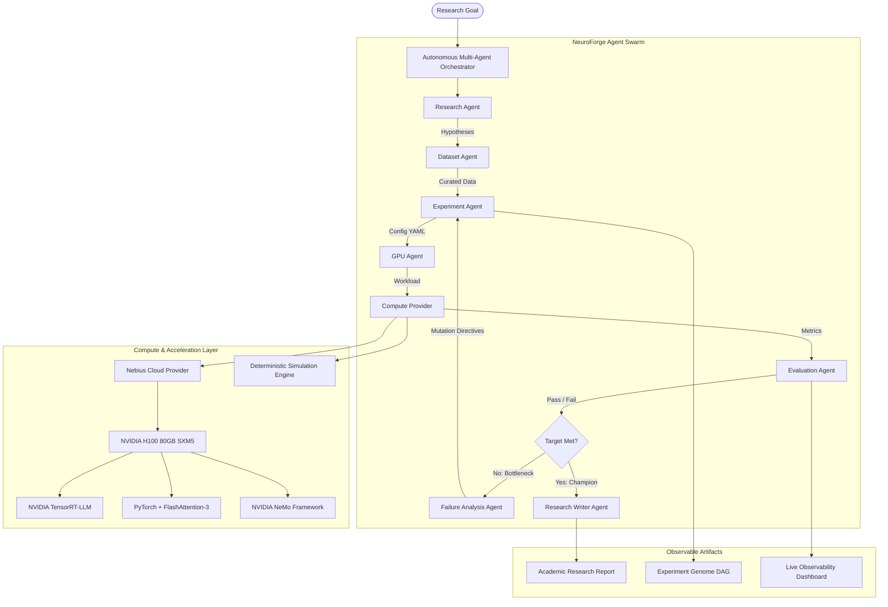

# 🚀 NEUROFORGE AI

> **Autonomous AI Research & Experimentation Lab**  
> *Hypothesize → Experiment → Train → Evaluate → Learn from Failure → Improve*

---

## 📌 Executive Summary

Modern AI research is constrained by manual trial-and-error: human practitioners guess hyperparameter mutations, manually submit GPU batch jobs, parse fragmented wandb logs, and intuitively iterate.

**NeuroForge AI** changes this paradigm by turning natural language research objectives into an **autonomous closed-loop experimentation operating system**.

A user provides a high-level research goal:
> *"Optimize a small language model for reasoning while minimizing inference latency and GPU memory."*

NeuroForge autonomously:
1. Deconstructs the research objective into boundary constraints.
2. Formulates falsifiable hypotheses (e.g. LoRA rank adaptation, FP8 weight quantization, KV-cache paging).
3. Selects and validates curated datasets (GSM8K, MATH, HumanEval).
4. Configures distributed GPU workloads.
5. Schedules and trains on **Nebius Cloud NVIDIA H100 SXM5** clusters.
6. Gathers real-time telemetry (accuracy, loss, TTFT latency, VRAM, thermal, and power).
7. Diagnoses bottlenecks (e.g., memory bandwidth saturation during token decode).
8. Generates evolutionary hyperparameter mutations to recover constraints.
9. Iterates through the search space to find the optimal **Pareto frontier**.
10. Preserves full lineage in the **Experiment Genome**.
11. Generates peer-review-grade research reports with one-click reproduction manifests.

---

## 🏗 System Architecture



---

## 🌟 Key Features

* **🧠 Research Command Center**: Define goals with interactive constraint sliders (Accuracy, Latency, VRAM, Throughput, and Budgets).
* **⚡ Live Research Execution**: Real-time agent event stream, stage pipeline stepper, and dynamic pause/resume/stop controls.
* **🧬 Experiment Genome**: Signature evolutionary tree tracing lineage from initial failed baselines to the champion configuration.
* **🖥 GPU Lab**: Enterprise hardware observability displaying cluster utilization, VRAM allocation, liquid cooling thermals, and power draw across worker nodes.
* **🔬 Automated Failure Analysis**: Root cause diagnosis (e.g., KV cache pressure, activation memory spikes) with automated hyperparameter mutations.
* **📊 Benchmarks & Pareto Leaderboard**: Real-time evaluation across GSM8K, MATH, HumanEval, and hardware latency profilers.
* **📄 Academic Report Generator**: Automated markdown and JSON reports detailing abstract, methodology, results, and Python reproduction scripts.
* **⌘K Command Palette**: Fast keyboard navigation across all views and one-click demo triggers.
* **🛡 Transparent Demo / Simulation Mode**: Realistic deterministic sample workloads when real Nebius credentials are not active, clearly labeled for hackathon evaluation.

---

## 🛠 Technology Stack

### Frontend
* **Framework**: Next.js 14 (App Router)
* **Language**: TypeScript
* **Styling**: Tailwind CSS (Dark-first technical design system)
* **Visualizations**: Recharts (Loss curves, VRAM, thermal, and throughput graphs)
* **Icons**: Lucide React
* **Motion**: Framer Motion & Canvas Confetti

### Backend
* **API**: FastAPI (Python 3.13)
* **Data Layer**: SQLAlchemy 2.0 (Async engine supporting SQLite & PostgreSQL)
* **Validation**: Pydantic V2
* **WebSockets**: Real-time bi-directional agent event stream
* **Multi-Agent Orchestration**: Structured state machine architecture (LangGraph compatible)

### Hardware & Compute Connectors
* **Cloud Infrastructure**: Nebius Cloud API & Slurm batch orchestrator
* **Accelerators**: NVIDIA H100 80GB SXM5
* **Execution Runtimes**: PyTorch 2.4, NVIDIA TensorRT-LLM, NVIDIA NeMo

---

## 🚀 Getting Started

### Prerequisites
* Node.js v18+ (v20+ recommended)
* Python 3.10+
* Docker & Docker Compose (optional, for containerized run)

### 1. Clone & Setup

```bash
git clone https://github.com/your-org/neuroforge-ai.git
cd neuroforge-ai
```

### 2. Environment Configuration

Copy the sample environment file:
```bash
cp .env.example .env
```

```env
APP_ENV=development
DEMO_MODE=true
GPU_PROVIDER=demo
NVIDIA_BACKEND=demo
```

### 3. Run Backend API

```bash
# Install dependencies
pip install -r apps/api/requirements.txt

# Start FastAPI server
cd apps/api
python -m uvicorn app.main:app --reload --port 8000
```
Backend will start at `http://localhost:8000`. Database is automatically initialized and seeded with the signature demo run `NF-027`.

### 4. Run Frontend

In a separate terminal:
```bash
cd apps/web
npm install
npm run dev
```
Open `http://localhost:3000` in your browser.

---

## 🐳 Docker Deployment

Run the complete multi-tier system with Docker Compose:
```bash
docker compose up --build
```
* Web Dashboard: `http://localhost:3000`
* API & Swagger Docs: `http://localhost:8000/docs`

---

## 🧪 Testing

Run backend test suite:
```bash
pytest apps/api/tests -v
```

---

## 🏆 Signature Hackathon Demonstration (2-Minute Walkthrough)

1. Open `http://localhost:3000`.
2. Notice the **SYSTEM OPERATIONAL** hardware pill and Nebius NVIDIA H100 status.
3. Click **[ RUN LIVE DEMO ]** in the Hero section or press `⌘K` → `Run Hackathon Live Demo`.
4. Watch the 7-stage autonomous loop:
   * **Stage 1**: Formulation of reasoning objectives (<150ms latency, <8GB VRAM).
   * **Stage 2**: Agent generates 8 hypotheses.
   * **Stage 3**: Validates GSM8K-Hard-Cleaned.
   * **Stage 4**: Baseline BF16 fails latency (214ms > 150ms).
   * **Stage 5**: Failure Analyst identifies KV-cache memory pressure.
   * **Stage 6**: Experiment Agent mutates configuration into FP8 + LoRA r=64.
   * **Stage 7**: 🏆 **Champion Experiment #08** crowns with 87.4% accuracy, 124ms latency, and 7.8GB VRAM.
5. Click **[ Explore Experiment Genome ]** to visually trace how the agent arrived at this champion configuration.

---

## 📄 License

Apache License 2.0. Built for the Nebius × NVIDIA AI Hackathon.
